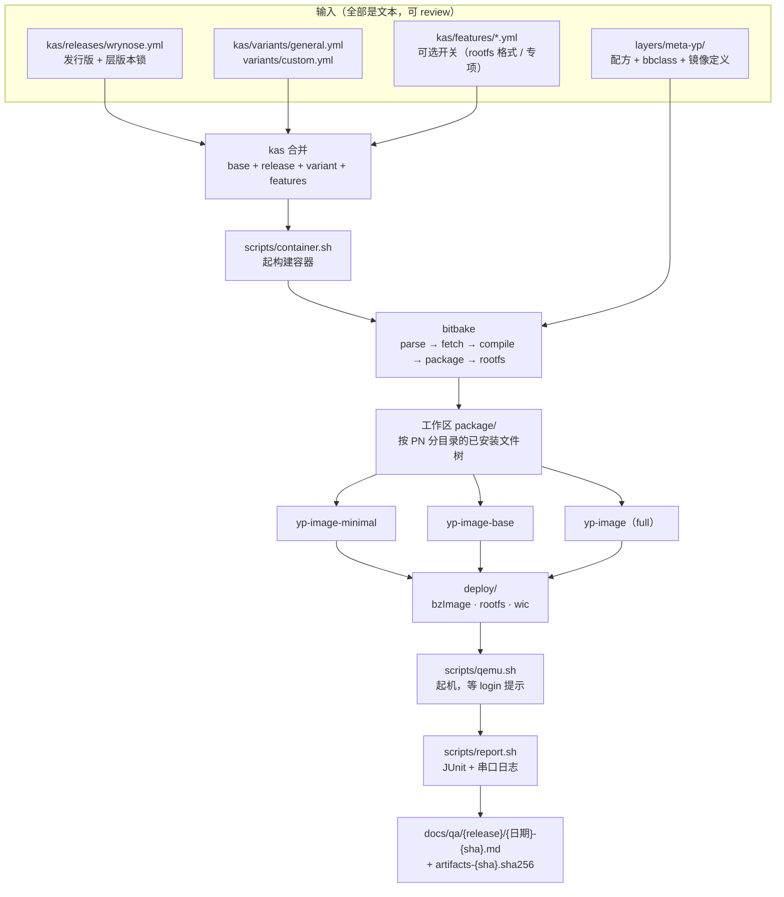
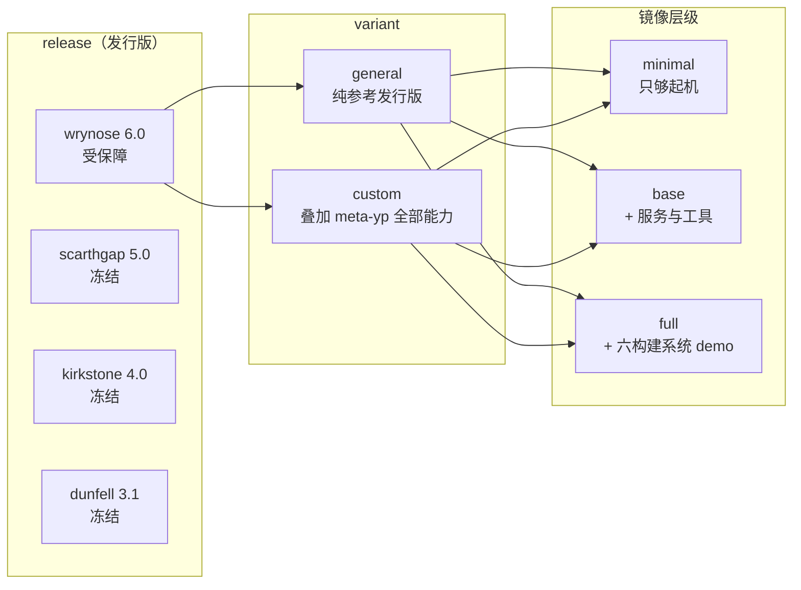
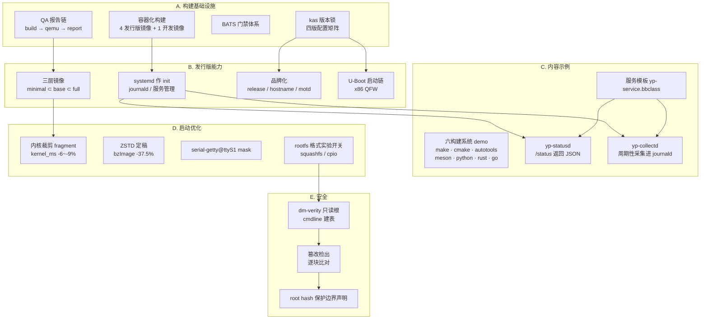
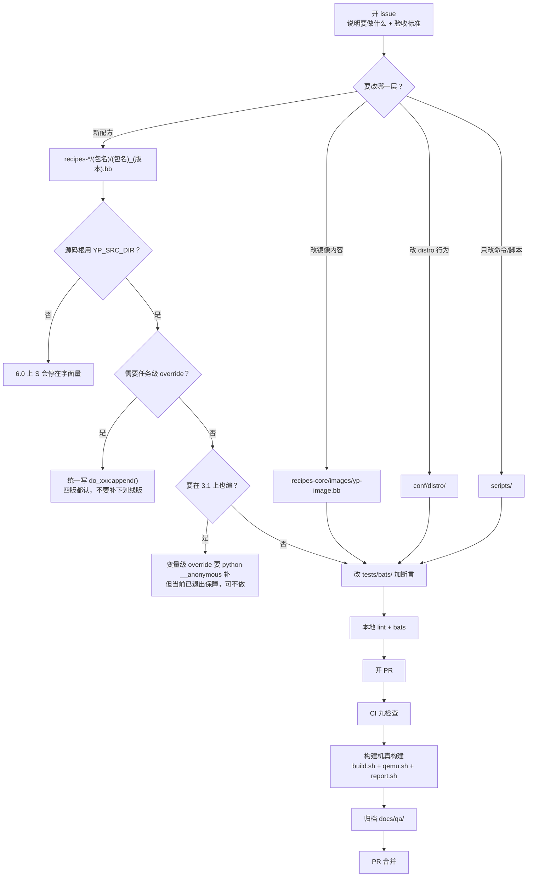
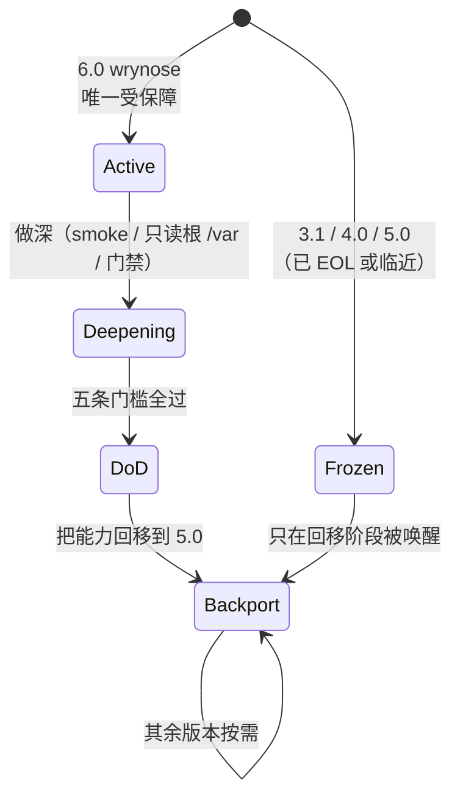

# 功能性流程

> 本文件回答一个问题：**这个仓库从一份配置能产出什么，经过哪些环节，每一步留下什么证据。**
> 它只描述「能力」，不描述「怎么证明能力是对的」——后者在
> [`verification-flow.md`](../01-requirements/verification-flow.md)；为什么这样组织在
> [`engineering-overview.md`](../06-process/engineering-overview.md)。
>
> **保障范围（2026-11-09 决策）**：只保障 **wrynose 6.0**。3.1 / 4.0 / 5.0 的
> 配置与配方**冻结保留、退出保障**（能读、不再构建、不承诺可用），
> 待 6.0 达到五条完成门槛后再回移。详见 [`engineering-overview.md`](../06-process/engineering-overview.md) §2。
>
> 最后更新：2026-11-09

## 1. 主链路：从配置到可起机镜像

一条构建 = **一个 release × 一个 variant × 一个镜像层级**。三个维度都由 kas 组合决定，
产物落在 `work/kas-<release>-<variant>/deploy/`。

**这条链上有三个「必须同时存在」的约束**，不符合就是断链：

| 约束 | 破了会怎样 | 守在哪 |
|---|---|---|
| 容器必须同时挂 `/etc/passwd` 与 `/etc/group` | `sstatesig` 用 `grp.getgrgid()` 解析 gid，缺了报「doesn't match any user/group」，只在 `do_package` 真执行时炸 | `scripts/container.sh` |
| 镜像层级必须体积单调（minimal ⊂ base ⊂ full） | 分包了但没装进去，三层退化成同一层 | `12_distro.bats` 断言 |
| 源码根必须走 `YP_SRC_DIR` | 6.0 用 `UNPACKDIR`，3.1–5.0 没有该变量；写死任一个都会让另一侧停在字面量 | `yp-service.bbclass`；`15/16/17_syntax.bats` |

## 2. 组合矩阵：为什么是这三个维度

- **release** 决定 Yocto 层版本（3.1/4.0/5.0/6.0），带来语法与 class 可用性差异。
- **variant** 决定是否叠 `meta-yp`。`general` 用来证明「meta-yp 可以被剥离」，
  `custom` 用来证明「叠上去也不破坏上游」。
- **镜像层级**用来证明分包设计成立，而不是一坨 full。

> `general` 这个 variant 的存在理由经常被误解成「省时间」。它不是——它是
> **可剥离性证据**：如果 meta-yp 只能整包用，这个仓库就只是个发行版，不是个可复用的层。

## 3. 能力分区：仓库里到底有什么

按能力域分成五组，每组标注**证据位置**。这一节是 `features.md` 的流程图版本，
区别是这里标出了模块之间的依赖。

### 3.1 每组的入口、产物与证据

| 组 | 你能改什么（入口） | 产物 | 证据在哪 |
|---|---|---|---|
| A 构建基础设施 | `scripts/container.sh`、`kas/`、`tests/bats/` | 可复现构建容器、配置组合、门禁结果 | CI 九个检查；`docs/qa/` |
| B 发行版能力 | `layers/meta-yp/conf/`、`recipes-core/images/`、`yp-uboot.inc` | 三层镜像、systemd 单元、品牌文件 | `docs/qa/*/…md`；`12_distro.bats` |
| C 内容示例 | `recipes-demo/`、`classes/yp-service.bbclass` | 9 个 demo 包、`yp-statusd`/`yp-collectd` | `13/16/17_bats`；起机后 `/status` |
| D 启动优化 | 内核 `.cfg` fragment、`IMAGE_FSTYPES`、systemd mask | 更小的内核、ZSTD 镜像、启动耗时数据 | `docs/qa/boot-baseline.md`；`docs/02-development/boot-optimization.md` |
| E 安全 | `scripts/dm-verity.sh`、`kas/features/` | 带 verity 的镜像 + hash 设备 | `docs/qa/security/dm-verity-feasibility.md` |

## 4. 一次「加功能」要经过哪些环节

这是仓库最常发生的一种改动。图上每一个菱形都是一个**可能卡住的地方**，
卡住时的排查入口写在表里。

**对应的排查入口**（卡住时看这里，不要猜）：

| 卡在哪 | 第一件事 |
|---|---|
| 解析期报 `old override syntax` | 变量级用了冒号，或下划线版进了 4.0+ 的层 |
| 解析期报 `Could not inherit file classes/xxx.bbclass` | 该 class 在当前 release 不存在（如 3.1 无 `cargo.bbclass`） |
| `do_compile` 报 not found | 先确认是不是同一任务跑了两遍（冗余 override 补丁） |
| `do_package` 报 `doesn't match any user/group` | 容器没挂 `/etc/group` |
| `do_rootfs` 报目录属性冲突 | 先查包元数据，再怀疑配方；旧 sstate 只能 `cleansstate` |
| 起机后行为不对 | 先看串口日志是不是目标镜像（experiment overlay 会残留） |

## 5. 状态机：6.0 主线与冻结版本

五条完成门槛（`DoD`）的原文在 [`engineering-overview.md`](../06-process/engineering-overview.md) §3。
**未达 `DoD` 之前不动 `Frozen` 里的任何东西**——这是这次范围决策的核心纪律，
理由不是「省事」，是「单点资源下同时保四版等于四版都不深」。

## 6. 明确不在图上的东西

画出来的图最容易被问「为什么没有 X」。这里先答：

| 不在图上 | 原因 |
|---|---|
| 真实硬件烧写 | 全部验证在 QEMU，未上过任何一块板；这是**主动声明**，不是遗漏 |
| arm64 / 其他架构 | 单架构策略，`qemuarm64` 暂停；扩架构会先暴露硬编码假设，不是加一行参数 |
| 增量 OTA / 镜像升级 | 无此能力。dm-verity 的只读根是「防篡改」，不是「可升级」 |
| 包管理源 / 在线安装 | 镜像内无 feed，`dnf`/`opkg` 只用于构建期装包 |
| 多用户 / 权限模型 | 默认 root，未做用户体系；服务以 root 跑 |
| 远程管理面 | 无 sshd 默认开启、无 agent、无上报 |

这六条是**边界声明**，写在这里比等评审者问出来强。技术分享场合尤其如此：
「清楚自己不是什么」比「声称什么都是」可信。

## 7. 相关文档

- 怎么证明上面每一步都对 → [`verification-flow.md`](../01-requirements/verification-flow.md)
- 为什么这样分层、为什么只保 6.0 → [`engineering-overview.md`](../06-process/engineering-overview.md)
- 四版语法差异（历史资产，保留） → [`syntax-matrix.md`](syntax-matrix.md)
- 服务怎么写 → [`adding-a-service.md`](adding-a-service.md)
- 启动链细节 → [`boot-chains.md`](boot-chains.md)
