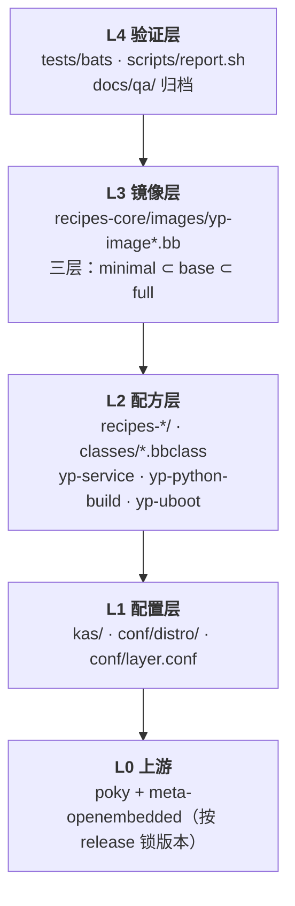
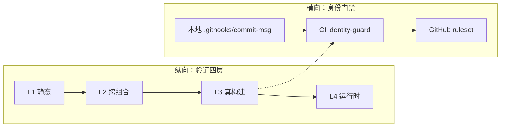
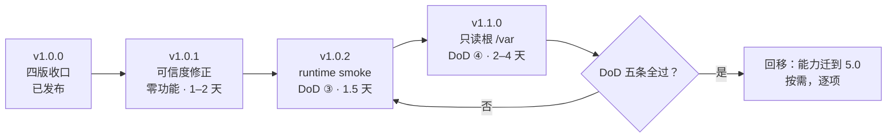

# 工程概述

> 面向第一次打开这个仓库的人：**它是什么、承诺什么、不承诺什么、为什么这样组织。**
> 想直接动手的看 [`getting-started.md`](../03-build/getting-started.md)；想知道每一步产物怎么来的看
> [`functional-flow.md`](../02-development/functional-flow.md)；想知道怎么证明它对看
> [`verification-flow.md`](../01-requirements/verification-flow.md)。
>
> 最后更新：2026-11-09

## 1. 一句话定位

**这是一个「Yocto 发行版工程 + 可复现验证管线」的参考实现，不是一个要出货的操作系统。**

它证明的是三件事：

1. 一套配置能稳定产出可起机的镜像（不是「我这台机器能编」）
2. 每份产物都有可核对的证据（commit / 命令 / 环境 / 阈值 / 摘要）
3. 边界写清楚了（哪些没做、哪些不承诺、哪些是故意不做）

类比：它不造车，它造的是**一条能复现造车过程的产线，并且每辆车出厂都附检测报告**。
所以评价它的标准不是「功能多不多」，而是「报告能不能对上」和「产线能不能被别人跑起来」。

## 2. 范围声明（2026-11-09 决策）

这是本文件最重要的一节。它把「我们做什么」收窄成一句可判定的话，
代价是放弃了一部分已有能力——**这个放弃是显式的**，理由在 §2.2。

| 维度 | 承诺 | 不承诺 |
|---|---|---|
| **发行版** | **wrynose 6.0 唯一受保障** | 3.1 / 4.0 / 5.0 冻结保留，能读、不再构建、不保证可用 |
| **架构** | **x86-64（qemux86-64）** | arm64 及其他架构暂停 |
| **运行环境** | **QEMU 起机验证** | 实体硬件（从未上过任何一块板） |
| **内容质量** | 静态门禁 + 构建 + 起机 + runtime smoke | ptest、内容级深度扫描（icebox） |
| **合规产物** | **SPDX SBOM + CVE 报告** | VEX、SBOM 与镜像一致性校验（不做） |
| **许可声明** | `THIRD_PARTY_NOTICES`（分发二进制时的义务） | FOSS 扫描（scancode）暂停 |

### 2.1 「冻结保留」的具体含义

不是删除，不是弃用，是**退出保障**：

- 配置（`kas/releases/*.yml`）、配方、兼容层、`docs/02-development/syntax-matrix.md` 全部留在 `main`
- 不再进 CI 矩阵、不再进回归、不再承诺「能编」
- 文档中一律标注「未保障（untested since v1.0.0）」
- 回移阶段被唤醒时，从现有代码继续，不需要考古

### 2.2 为什么收缩

三条理由，按权重排序：

1. **单点资源下，四版都保 = 四版都不深。** 一个人的 5–10 小时/周，摊到 4 个发行版上
   只能维持「能编 + 能起机」，而这恰好是最浅的一层——`#109` 型事故正是在
   「构建成功 + 能起机 + 207 项静态断言全绿」的情况下发生的。
2. **3.1 与 4.0 已 EOL，5.0 到 2028-04。** 为一个没有安全更新的版本做深度保障，
   投入产出不成立。它们的价值是**语法差异知识**，而知识已经在
   `docs/02-development/syntax-matrix.md` 里，不需要持续构建来维持。
3. **验证深度比版本广度更能说明工程能力。** 对技术评审来说，「一个版本做到可举证」
   的说服力高于「四个版本都能起机」。

> 这次收缩在对外叙事上是一次**能力回退**（v1.0.0 宣称四版全兼容）。
> 处理方式是不回避：Release 页与 README 都写明「v1.0.0 的四版覆盖是历史峰值，
> 后续支持范围收窄至 6.0」，并把理由放在这里。**藏着才会被当成退步，写明就是取舍。**

## 3. 6.0 的完成门槛（DoD）

「等 6.0 全部做完再迁移」这句话，如果没有可判定的终点，就等于「永远不迁移」。

终点是**两条并列条件，两条都要满足**：

### 条件 A：功能证据矩阵全绿

`config/features.txt` 里 **25 条 feature**，每条达到自己应有的证据级别（`static` / `build` / `boot` / `runtime`），无一条低于应达档位。

矩阵在 [`verification-flow.md`](../01-requirements/verification-flow.md) §6，逐条给出「用什么验、在哪验、现在到没到」。

**当前（2026-11-09）**：25 条中 ✅ 17 条、⚠️ 6 条、⬜ 0 条。

其中 6 条 ⚠️ 分两类，**性质完全不同**：

| 类别 | 条目 | 是不是缺口 |
|---|---|---|
| 一次性取证，不可复现 | `yp-service` / `demo-statusd` / `demo-collectd` | **是**，`#132` 解决 |
| 显式降级，有登记有理由 | `foss-scan` / `do-scancode` / `distro-backfill` | 否，是决策不是缺陷 |

### 条件 B：五条关键路径门槛

| # | 门槛 | 判定 | 当前 | 归属 |
|---|---|---|---|---|
| ① | 构建全绿 | 6.0 × 2 variant × 3 层镜像，`N tasks all succeeded`，无 error | ✅ `20261104-ad7c52d` 202/202/0/0 | 已达成 |
| ② | 起机到 login | QEMU 串口出现 `login:`，无 panic | ✅ 各组合串口全命中 | 已达成 |
| ③ | 内容能用 | runtime smoke 动作集全部 rc=0，`failed units` = 0 | ⬜ 规格已定（§6.3），未实现 | `#132` → v1.0.2 |
| ④ | 只读根可用 | dm-verity 镜像下 `/var` 可写（`/var/lib` 不再只读），`journald` 能落盘 | ⬜ 只有 `ro`，靠 tmpfs 兜底 | `#133` → v1.1.0 |
| ⑤ | 宣称与事实一致 | 镜像 banner 版本 = 最近 tag；README 能力清单 = 实测能力 | ⬜ banner 仍显示 0.3.0 | `#130` → v1.0.1 |

### 为什么是两条，不是一条

- **条件 A 管「所有功能」**：它防止「构建绿了、起机了，就说 6.0 做完」——那种状态下还有三条服务的运行时证据不可复现。
- **条件 B 管「关键路径」**：它防止「每条功能都点到为止，但 `/var` 不可写」——那种状态下 dm-verity 镜像是「能演示」不是「可用」。

**A 全绿而 B 未过，不算完成；B 全过而 A 有 ⚠️ 真缺口，也不算。** 只有两条同时满足，才允许开始回移 5.0。

> 里程碑 `v1.0.1 · 6.0 全面收口` 的关闭条件写的就是这两条。它内部含三个发布批次：
> 修正 → `v1.0.1`、验证 → `v1.0.2`、功能 → `v1.1.0`。里程碑与 tag 不是 1:1，
> 这是刻意的——理由见里程碑描述。

## 4. 架构分层

四层，每层只依赖下一层。跨层改动的成本远高于同层改动——这是排查时先判断「改的是哪层」的原因。

| 层 | 改这里会发生什么 | 典型耗时（改一次到看到结果） |
|---|---|---|
| L1 配置 | 全量重建概率最高；distro 哈希一变，sstate 大面积失效 | 小时级 |
| L2 配方 | 只重建受影响包及其下游 | 十几分钟到小时 |
| L3 镜像 | 只重跑 `do_rootfs` 与镜像打包 | 分钟到十几分钟 |
| L4 验证 | 秒到分钟 | 秒级 |

> **反直觉但必须记住**：改 L1 的 `DISTRO_VERSION` 会让第一次构建明显变慢，
> 因为 distro 哈希变了、sstate 大范围失效。这是正常现象，不是环境坏了。

## 5. 技术选型与取舍

每条都是一个「选了 A 没选 B」的判断，附理由。没有理由的选型会在半年后变成谜。

| 决策点 | 选的 | 没选的 | 理由 |
|---|---|---|---|
| 构建编排 | **kas**（YAML 分层合并） | repo + 手写脚本；直接改 poky | 配置可 review、可组合、可锁版本；缺点是引入一层间接 |
| 版本隔离 | **独立 work 目录 + 容器** | 多 checkout 切换；chroot | 隔离彻底，代价是磁盘；容器还解决了宿主 UID 与 pseudo 的冲突 |
| 门禁 | **bats** | pytest；自定义 Python | shell 生态原生、无额外依赖；缺点是断言偏静态、且 1.2 与 1.14 行为有差异 |
| 镜像分层 | **三个 image recipe** | 一个 recipe + 条件变量 | 分层是「能裁剪」的证据；条件变量写多了无法证明层间差异 |
| 参考版本 | **6.0 wrynose** | 5.0 scarthgap | 6.0 是新变量语法与 `UNPACKDIR` 的起点，向前兼容比向后兼容便宜 |
| 只读根 | **cmdline `dm-mod.create` 建表** | initramfs + UEFI | 少一个启动阶段、少一个组件；代价是 cmdline 变长且要手工算表 |
| 验证环境 | **QEMU** | 实体硬件 | 可复现、可 CI 化；代价是板级时序与外设未覆盖 |
| 签名 | **不做**（只声明边界） | 自建签名链 | 没有真实威胁模型时，签名链是纯成本；边界声明已覆盖对外表述需要 |

## 6. 质量体系

两条正交的轴：**纵向四层验证**（见 [`verification-flow.md`](../01-requirements/verification-flow.md)），
**横向三道身份门禁**。

三道身份门禁是互补的，不是冗余：本地钩子可以被 `--no-verify` 绕过，CI 可以被
分支保护绕过（如果没配），ruleset 是最后一道。三层同时存在才能说「不可绕过」。

> 已知例外：网页上直接 Merge 会产生 GitHub 合成身份
> （`…@users.noreply.github.com`），现存 9 条。这是**显式豁免**，不是漏网——
> 不重写历史的原因是第三次重写会再次重置全部 SHA，代价远大于收益。

## 7. 资源画像

说清资源约束，才能理解为什么很多事「知道该做但不做」。

| 项 | 现状 | 影响 |
|---|---|---|
| 人力 | 单人，5–10 小时/周 | 同时只能推进一条线；「并行」等于两条都慢 |
| 构建机 | 一台（可基本独占） | 全量回归是串行的；单点故障无备份 |
| CI | GitHub 免费额度 | 静态层可以放开跑，真构建不能进 CI（镜像与时长） |
| 知识 | `docs/06-process/knowledge-base.md` KB-01~32 | 已外化，但无第二人验证过（bus factor = 1） |

**这条约束直接解释了三件事**：为什么只保一个版本、为什么 ptest 进 icebox、
为什么 arm64 暂停。它们都不是「不重要」，是「在这个资源下做了会拖垮主线」。

## 8. 路线

| 版本 | 主题 | 具体内容 | 性质 |
|---|---|---|---|
| **v1.0.1** | 可信度修正 | `DISTRO_VERSION` → 1.0.0；断言改为「与最近 tag 比对」；README / handover / roadmap / milestones / features 同步；范围收缩声明进 README；合成身份 9 条显式登记 | 零功能 |
| **v1.0.2** | 可讲性 | runtime smoke 实现（规格见 `verification-flow.md` §6）；未保障清单进 README | 测试能力 |
| **v1.1.0** | 功能补全 | 只读根 `/var` overlay；顺带 QEMU 上 arm64 抽测一次（只记录不承诺） | 功能 |

**纪律：v1.0.1 里不许顺手做 `/var` overlay。** 功能混进补丁版会让版本号失去信息量，
v0.5~v0.7 就是这么丢掉版本语义的。

## 9. 已知边界

主动声明，不是等人来问。这一节的目的是让读者**在相信之前就知道该怀疑什么**。

| 边界 | 说明 |
|---|---|
| **未上真板** | 全部证据来自 QEMU。板级时序、电源管理、真实外设、Flash 寿命均未验证 |
| **单架构** | 只有 x86-64。arm64 的交叉编译与启动链未验证 |
| **只读根只能演示** | dm-verity 镜像能起机、能检出篡改，但 `/var` 不可写，长期运行不成立（v1.1.0 补） |
| **无升级路径** | 没有 OTA、没有 A/B、没有增量更新。只读根是「防篡改」不是「可升级」 |
| **无用户体系** | 默认 root，无 sshd 默认开启，无远程管理面 |
| **无签名链** | 只保护 root hash 的完整性边界，不防「整镜像替换」 |
| **合规仅两件** | SPDX + CVE。无 VEX、无 SBOM 一致性校验，不是 CRA 意义上的完整技术文档 |
| **bus factor = 1** | 单人维护，无第二人独立验证过全流程 |

## 10. 文档地图

按「你想知道什么」索引，而不是按目录结构。

| 你想知道 | 看这个 |
|---|---|
| 这仓库是什么、承诺什么 | 本文件 §1–§3 |
| **每条功能是什么、怎么用、边界在哪** | [`features.md`](../01-requirements/features.md) |
| **工程结构为什么这样（分层/class/注入点/扩展）** | [`design.md`](../02-development/design.md) |
| 从配置到镜像经过哪些环节 | [`functional-flow.md`](../02-development/functional-flow.md) |
| **怎么证明产物是对的、我怎么自己验（兼测试文档）** | [`verification-flow.md`](../01-requirements/verification-flow.md) |
| 第一次上手跑起来 | [`getting-started.md`](../03-build/getting-started.md) |
| 四版语法差异（历史资产） | [`syntax-matrix.md`](../02-development/syntax-matrix.md) |
| 怎么加一个服务 | [`adding-a-service.md`](../02-development/adding-a-service.md) |
| 启动链为什么这样 | [`boot-chains.md`](../02-development/boot-chains.md) |
| 构建容器与 UID 问题 | [`container.md`](../03-build/container.md) |
| 踩过的坑（KB-01~32） | [`knowledge-base.md`](knowledge-base.md) |
| 接手时先看什么 | [`handover.md`](handover.md) |
| 待办与优先级 | [`backlog.md`](backlog.md) |
| 历史运行记录 | [`qa/`](../qa/) |
