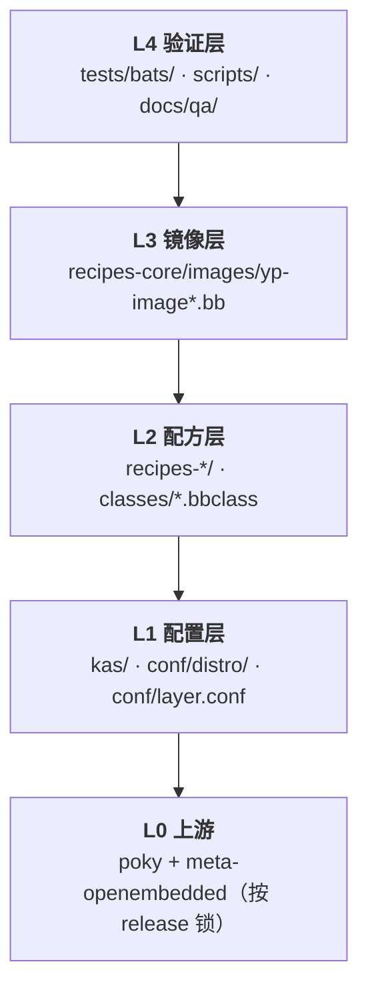
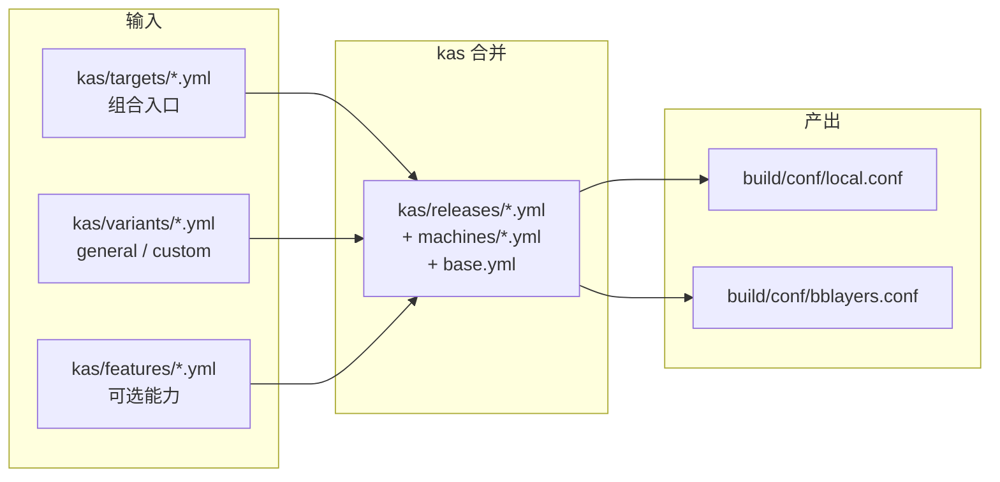

# 设计说明

> 本文件回答一个问题：**这套东西为什么长成现在这样。**
>
> 想知道它是什么、承诺什么 → [`engineering-overview.md`](engineering-overview.md)
> 想知道数据怎么流动 → [`functional-flow.md`](functional-flow.md)
> 想知道怎么证明它对 → [`verification-flow.md`](verification-flow.md)
> 想知道踩过哪些坑 → [`knowledge-base.md`](knowledge-base.md)
>
> **本文件讲结构意图，不是踩坑记录。** 一条 KB 可能对应一条设计决策，反之不然。
>
> 最后更新：2026-11-09

## 1. 三个硬约束，以及它们怎么塑造了结构

设计不是先想出来的，是被约束逼出来的。这个项目的三个约束决定了后面所有取舍：

| 约束 | 具体值 | 直接后果 |
|---|---|---|
| **单点人力** | 1 人，5–10 小时/周 | 任何「双实现」都是禁止的；`#117` 的两条 dm-verity 路线因此砍掉一条 |
| **单台构建机** | 1 台（可基本独占） | 回归必须能串行跑完，不能有交互式步骤；工具有「一条命令跑全量」的形态 |
| **只有 QEMU** | 无实体硬件、单架构 | 验证口径全部围绕串口日志与客户机内命令设计 |

反过来说，凡是看起来「过度设计」的地方，多数是在补这三个约束带来的缺口：

- **为什么有 `docs/qa/*.sha256`**：因为没人能现场看着构建，事后必须能核对产物与记录是同一份
- **为什么有 `deploy-guard.sh`**：因为 `runqemu` 会悄悄用到旧部署，而没人盯着屏幕
- **为什么有三道身份门禁**：因为单点维护下，历史被污染就没有第二个人能发现

## 2. 五层结构与依赖方向

只有一条规则：**每层只允许依赖下一层，不允许反向或跨层。**



**跨层的成本差异是数量级的**，这决定了排查时第一件事是判断「改的是哪层」：

| 层 | 典型改动 | 发生什么 | 到看到结果的耗时 |
|---|---|---|---|
| L1 | `conf/distro/`、`kas/` | distro 哈希变化，sstate 大面积失效 | 小时级 |
| L2 | 配方、class | 只重建受影响包及其下游 | 十几分钟到小时 |
| L3 | image recipe、`.inc` | 只重跑 `do_rootfs` 与打包 | 分钟到十几分钟 |
| L4 | bats、脚本、文档 | 只跑断言 | 秒到分钟 |

> **反直觉但必须记住**：改 L1 的 `DISTRO_VERSION` 会让第一次构建明显变慢。
> 这不是环境坏了，是 distro 哈希变了。`#130` 会踩到这个。

### 2.1 为什么 L1 拆成五个文件

`layers/meta-yp/conf/distro/include/` 下五个文件不是随手分的，每个对应一种**变更频率**：

| 文件 | 管什么 | 变更频率 | 为什么单独 |
|---|---|---|---|
| `yp.conf` | distro 主体：`DISTRO_FEATURES`、`PREFERRED_PROVIDER` | 低 | 改动会全量重建，要与高频项隔离 |
| `yp-common.inc` | 与 release 无关的公共设置 | 低 | — |
| `yp-compat.inc` | **只放跨版本语法差异** | 低但危险 | 见 §5.2，这是唯一允许写版本分支的地方 |
| `yp-release.inc` | `DISTRO_VERSION`、品牌串 | 每次发版 | 发版必改，与结构项分离 |
| `yp-uboot.inc` | U-Boot 启动链 | 低 | 只影响启动链，与 distro 主体解耦 |

`yp-compat.inc` 的文件头写着一条纪律：**release 相关的语法差异只能出现在这个文件里**。目的是让「四版兼容」这件事有一个可搜索的边界——排查跨版本问题时只需要看一个文件。

### 2.2 三层镜像为什么是三个 recipe

`yp-image-minimal.bb` / `yp-image-base.bb` / `yp-image.bb`（full），公共部分在 `yp-image.inc`。

没选「一个 recipe + 条件变量」，原因是：**条件变量写多了就无法证明层间差异**。

`12_distro.bats` 断言三层体积单调递增。如果三层是一个 recipe 靠变量切换，那么「minimal 到底少了什么」只能靠读条件表达式推断；现在则可以直接 diff 两个 recipe，且 `yp-image.inc` 里写明包含关系必须保持 `minimal ⊂ base ⊂ full`——这个包含关系同时是**启动三点基线**成立的前提（裸底多快 / 有工具之后慢多少 / 有服务再慢多少）。

顺带一个真实约束：`IMAGE_FSTYPES` 与 `IMAGE_ROOTFS_SIZE` **故意不写死在 `yp-image.inc`**，因为写死会连带影响 3.1 的历史产物名（dunfell 没有 `ext4.zst`），而报告链路按 `.rootfs.<fstype>` 匹配。

## 3. 配置注入点：改哪里，波及什么

这是本文件最实用的一节。所有「我想改 X」都应该能在这里找到落点。



| 我想改 | 改这个 | 波及 |
|---|---|---|
| 加/减一个发行版 | `kas/releases/<r>.yml` + `kas/targets/<r>-*.yml` + lock 文件 | 全量构建 |
| 改 variant 的差异 | `kas/variants/{general,custom}.yml` | 该 variant 全量 |
| 加一个可选能力（如 SPDX） | `kas/features/<f>.yml` | 只影响启用它的组合 |
| 改 distro 特性 | `conf/distro/yp.conf` | 全量，sstate 大范围失效 |
| 改版本号/品牌串 | `conf/distro/include/yp-release.inc` | 全量，sstate 大范围失效 |
| 改镜像内容 | `recipes-core/images/yp-image*.bb` 或 `.inc` | 只重跑 `do_rootfs` |
| 加一个包 | `recipes-*/<pkg>/` + image 的 `IMAGE_INSTALL` | 该包 + rootfs |
| 改跨版本行为 | `conf/distro/include/yp-compat.inc` | 取决于内容 |
| 改容器环境 | `scripts/container.sh` + `docker/` | 全量重新构建镜像 |

### 3.1 kas 分层的六个维度

`kas/` 下 26 个 yml 按六个维度切分，组合方式是**笛卡尔积 + 覆盖**：

```
base.yml（machine / distro / 共享 DL_DIR SSTATE_DIR / CVE 库离线化）
  ├── machines/{qemux86-64,qemuarm64}.yml
  ├── releases/{dunfell,kirkstone,scarthgap,wrynose}.yml
  ├── variants/{general,custom}.yml
  ├── features/{cve,spdx,uboot,rootfs-cpio,rootfs-squashfs}.yml
  └── targets/<release>-<variant>.yml          ← 组合入口，人只调这个
        └── targets/<release>-<variant>.lock.yml  ← 锁住的完整展开
```

**为什么要 lock 文件**：`targets/*.yml` 只有十几行引用，真实的完整配置在 `.lock.yml` 里。好处是 review 时看 diff 能立刻发现「上游版本变了」，而不用展开 26 个文件拼一遍。

## 4. class 设计：四个类，四种职责

`layers/meta-yp/classes/` 下四个 class。切分标准是**「什么情况下会改它」**，不是功能相近性。

| class | 解决什么 | 什么时候会改 | 边界 |
|---|---|---|---|
| `yp-service.bbclass` | 把「装 unit + 建 user + 写 config」收敛成一行 | 服务模板本身要加字段时 | 只管 systemd 单元，不管 socket 激活与 timer |
| `yp-python-build.bbclass` | 按 **class 文件实际位置**判别该用 `python_setuptools_build_meta` 还是 `setuptools3` | 上游 class 再搬家时 | 只管构建入口选择，不碰打包 |
| `yp-spdx-legacy-license.bbclass` | 处理 3.1 的 SPDX 许可写法差异 | 只与 3.1 有关 | 兼容性补丁，不是能力 |
| `yp-sdk-ext-workaround.bbclass` | eSDK 在 dunfell 上的已知问题绕行 | 只与 3.1 有关 | 同上 |

**为什么不做一个大 class**：后两个是**兼容性补丁**，随版本冻结会自然死亡；前两个是**能力**，会持续演进。混在一起会让「哪些代码是能力、哪些是补丁」变得不可分辨，而冻结 3.1/4.0 时正需要这个分辨能力。

### 4.1 `yp-service.bbclass` 的接口设计

只暴露两个必填变量，其余走默认：

```bitbake
YP_SERVICE_NAME ?= "${PN}"                    # 默认等于包名
YP_SERVICE_UNIT ?= "${YP_SERVICE_NAME}.service"
```

`do_install:append()` 里只调一个函数 `yp_service_install_unit`。

> **这里有一个曾经踩过的坑，值得记下来**：早期为了兼容 3.1，给每个 `do_install:append` 又写了一份 `do_install_append`，结果 3.1 上**两份都生效**，同一任务跑两遍，症状是莫名的 `xxx: not found` exit 127。实测（3.1.33 / BitBake 1.46，探针配方）证明**任务级冒号语法 3.1 是认的**，冗余补丁已全部删除。详见 §5.2。

## 5. 配方约定

### 5.1 源码落点：`S = "${YP_SRC_DIR}"`

所有带本地源码的配方统一写成：

```bitbake
S = "${YP_SRC_DIR}"
```

`YP_SRC_DIR` 是工程别名，定义在 `yp-service.bbclass` 与 `kas/base.yml`：

```bitbake
YP_SRC_DIR ?= "${@d.getVar('UNPACKDIR') or d.getVar('WORKDIR')}"
```

原因：`UNPACKDIR` 只有 **6.0 引入**，3.1~5.0 上它是个不存在的变量。如果直接写 `S = "${UNPACKDIR}"`，在旧版本上 `S` 会停在字面量 `${UNPACKDIR}`，源码路径直接找不到。

反过来写 `S = "${WORKDIR}"` 在 6.0 上是错的——6.0 起源码解包到 `${WORKDIR}/sources`，`WORKDIR` 不再等于源码根。

`15/16/17_syntax.bats` 断言的就是「demo 配方必须走 `YP_SRC_DIR`」，而不是断言某个具体展开值。

### 5.2 override：变量级与任务级是两件事

这是本仓库最容易记混的一条，**必须在动手前分清楚**：

| 场景 | 3.1 | 4.0+ | 能不能双写 |
|---|---|---|---|
| **变量级** `FILES:${PN}-x` | ❌ 不认冒号 | ✅ 只认冒号 | ✅ **两种各写一行**，未命中的那行是惰性变量 |
| **任务级** `do_install:append()` | ✅ **认冒号** | ✅ 认冒号 | ❌ 双写会执行两遍 |

变量级的双写模式（`yp-compat.inc` 有完整说明）：

```bitbake
FILES:${PN}-cus = "a"      # 4.0+ 生效
FILES_${PN}-cus = "a"      # 3.1 生效
```

**但下划线版的变量级写法在 4.0+ 是致命的**：`data_smart.py` 会报「old override syntax」，而且这个错误会挂到**所有求值到同名变量的 recipe**，连上游 `base-files`、`systemd` 一起红。所以变量级只能双写，不能只留下划线版。

任务级不能双写，原因是 3.1 认冒号——两行都生效，任务跑两遍。**这是曾经真实发生过的 bug**（见 §4.1 的引用块）。

如果确实需要按版本改任务行为，且不能用 override 表达，只能用 `python __anonymous()` 在解析期改：

```bitbake
python __anonymous() {
    if "dunfell" in (d.getVar("LAYERSERIES_CORENAMES") or "").split():
        d.setVar("IMAGE_INSTALL_append", " yp-branding")
}
```

`IMAGE_INSTALL` 就是典型例子：`IMAGE_INSTALL:append` 在 3.1 静默失效（冒号不认），`IMAGE_INSTALL_append` 在 4.0+ 是致命解析错误（不能留），所以唯一的办法是解析期补。

> **注意这条的失败模式**：漏了这段 python 的后果不是构建失败，而是 **`yp-branding` 静默不进镜像**——构建成功、起机能跑，只是 `/etc/os-release` 里没有品牌字段。这类「静默不生效」正是 `verification-flow.md` 里 L4 存在的理由。

### 5.3 为什么不能改用「独立任务 + addtask」

一个看起来更干净的替代方案是：自定义任务装服务文件 + `addtask` 挂到 `do_install` 之后。**这个方案不可用**，原因是：

自定义任务不在 `PSEUDO_TASKS` 里，不经 pseudo → 装出来的文件属主是**真实宿主 uid**，而 `do_package_qa` 会判 `host-user-contaminated`。

这是「pseudo 只在声明过的任务里生效」这一机制的直接后果，不是配置问题。

## 6. 扩展方式

### 6.1 加一个包

```bash
# 1. 在 layers/meta-yp/recipes-demo/ 下新建目录并写配方，S 用 YP_SRC_DIR
# 2. 加进镜像：layers/meta-yp/recipes-core/images/yp-image.bb 的 IMAGE_INSTALL
# 3. 加 bats 用例并在 config/features.txt 注册（99_coverage 会强制）
```

**卡点**：第 3 步不是可选的。`99_coverage.bats` 的 Test 3 会检查「每个 bats 文件都被 features.txt 引用」，Test 1 检查「每个 feature 引用的 bats 文件存在」。

### 6.2 加一个服务

见 [`adding-a-service.md`](adding-a-service.md)。要点是 `inherit yp-service` + 两个变量，其余走默认。

**卡点**：服务的 unit 必须真的被 `systemctl enable`，否则起机后 `is-enabled` 返回 `disabled`——静态断言看不出来，要等 smoke。

### 6.3 加一层镜像

在三层之间插一层（如 `base` 与 `full` 之间加 `server`）时，必须同步三处：

1. 新 recipe `yp-image-server.bb`，`require yp-image.inc`
2. `12_distro.bats` 的体积单调断言顺序
3. 启动三点基线会变成四点——`docs/qa/boot-baseline.md` 的口径要改

**卡点**：这不是「加个文件」的改动，它改变了基线口径。

### 6.4 加一个 release

1. `kas/releases/<r>.yml`（锁 poky 版本 + 该版的语法差异）
2. `kas/targets/<r>-{general,custom}.yml` + 两个 lock 文件
3. `docker/Dockerfile.<r>`（基础镜像 Ubuntu 版本要对上）
4. 在受保障版本清单里加一行（`#127` 引入的那个文件，决定它进不进 CI 与回归）
5. `conf/distro/include/yp-compat.inc` 补该版的语法差异
6. `docs/syntax-matrix.md` 加一列

**卡点**：第 4 步是「是否受保障」的唯一开关。只加前 3 步等于「能构建但不受保障」——这正是 3.1/4.0/5.0 现在的状态。

## 7. 关键设计决策

`engineering-overview.md` §5 已经列了 8 条技术选型的「选了什么 / 没选什么 / 为什么」。这里只展开**实现层**的补充，不重复结论：

| 决策 | 实现层的具体代价 |
|---|---|
| kas 而非 repo | 多一层 YAML 间接；换来的是 lock 文件可 diff、组合可 review |
| 独立 work 目录 + 容器 | 磁盘占用大（每组合一份 build tree）；换来隔离彻底，且容器解决了宿主 UID 与 pseudo 的冲突 |
| 三个 image recipe | 三份 recipe 要同步维护；换来「层间差异可 diff」 |
| cmdline `dm-mod.create` 建表 | cmdline 变长且要手工算表（`dm-verity.sh` 里那段 python）；换来少一个启动阶段 |
| bats 而非 pytest | 断言偏静态、1.2 与 1.14 行为有差异；换来 shell 生态原生、无额外依赖 |

## 8. 已知设计债

每条写明「绕的是什么坑」与「什么时候可以还」。

| 债 | 绕的坑 | 什么时候还 |
|---|---|---|
| `yp-compat.inc` 里的版本分支 | 3.1 不认变量级冒号 | 3.1 彻底移出仓库时（不是冻结，是删除） |
| 两个 3.1 专用 class | dunfell 的 SPDX 与 eSDK 差异 | 同上 |
| `scripts/container.sh` 手工生成 `/etc/passwd` 与 `/etc/group` | 宿主 UID 与镜像 `builder` UID 不一致，且 `sstatesig` 会用 `pwd.getpwuid()` **和** `grp.getgrgid()` | 上游支持 `--userns` 与 pseudo 协作时 |
| `release-check.sh` 串行跑组合 | 单台构建机 | 有第二台机器时 |
| 静态断言占 207 项中的绝大多数 | 静态断言秒级、可 CI；运行时验证需要构建机 | 已排期：`#132` runtime smoke |
| `docs/ci.md` 与 `docs/handover.md` 的状态会漂 | 手工维护，无生成机制 | `#135` 之后靠 `plan-sync.sh` 覆盖 issue 侧，文档侧仍需手工 |

### 8.1 一条不算设计债但容易被误读的地方

`kas/base.yml` 里 `DL_DIR` / `SSTATE_DIR` 写的是 `${TOPDIR}/../../downloads`——**`../..` 是刻意的**，指向共享的 `work/`。只用 `..` 会退化成每个 release 一份缓存，磁盘与命中率都会崩。

这类「看起来写错了其实是对的」的值，建议在改动前先读该行上方的注释。它们几乎都有注释，因为写的时候就知道会被误读。

## 9. 相关文档

- 承诺与边界 → [`engineering-overview.md`](engineering-overview.md)
- 主链路与产物 → [`functional-flow.md`](functional-flow.md)
- 证据与阈值 → [`verification-flow.md`](verification-flow.md)
- 跨版本语法差异 → [`syntax-matrix.md`](syntax-matrix.md) / [`kas.md`](kas.md)
- 踩坑结论 → [`knowledge-base.md`](knowledge-base.md)
- 容器与 UID → [`container.md`](container.md)
