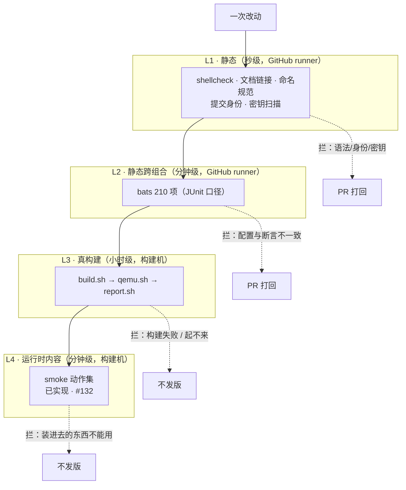
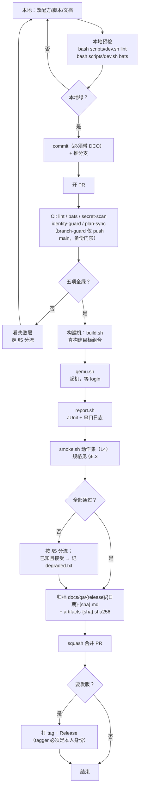
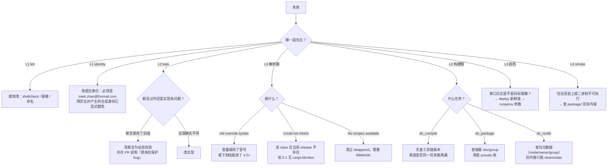

# 可验证性与测试说明

> 本文件回答一个问题：**别人凭什么相信这里的产物是对的，以及他自己怎么复核。**
> 功能性流程在 [`functional-flow.md`](functional-flow.md)——那里讲「做出了什么」，
> 这里讲「怎么证明它是真的」。
>
> **本文件同时是测试文档**：§1 讲验证分层，§2.5 定证据级别，§4 定阈值，
> §5 讲失败分流，§6 是**功能 → 证据映射矩阵**（26 条 feature 逐条对应验证方法），
> §7 是外部复现命令。
>
> **验证边界（2026-11-09 决策）**：全部验证在 **QEMU + x86-64** 上完成。
> 不使用实体硬件，不覆盖 arm64。这两个边界是**主动声明**，写在 README 显眼位置，
> 不是等被问出来再解释。
>
> 最后更新：2026-11-12（#135：新增 §2.5 证据级别定义；§6 矩阵 26 条对齐 `features.txt`；L4 smoke 已实现 #132）

## 0. 先把三个词定死

这三个词在本仓库有严格含义，混用会导致「看起来验证过」的假象。

| 词 | 这里的定义 | 不算 |
|---|---|---|
| **证据** | 能定位到 commit、命令、环境、阈值、产物摘要五要素的产物 | 一句「跑过了」、一张截图、一次口头确认 |
| **可复现** | 另一个人在同版本仓库上照抄命令，得到同一结论 | 「我这能跑」 |
| **通过** | 有明确判定阈值且实际达到 | 「没有报错」 |

判据的顺序很重要：**先有阈值，再看结果**。反过来就是给结果找解释。

## 1. 四层验证全景

四层的划分依据是**反馈时长**和**能发现什么类型的错**，不是「重要性」。
每层的存在理由都是「上一层的盲区」。



**每层的盲区，也就是下一层存在的理由**：

| 层 | 能发现 | **发现不了** | 所以下一层补什么 |
|---|---|---|---|
| L1 | shell 语法、身份、密钥、文档死链 | 任何 Yocto 语义 | 配方与配置的静态一致性 |
| L2 | 配置项写错、断言与现实不符、文件缺失 | 能不能真的编出来 | 真构建 |
| L3 | 解析错误、构建失败、起不到 login | **装进去的东西能不能用** | 运行时内容验证（L4） |
| L4 | 二进制存在但不可执行、库缺失、服务假活 | 上游测试是否全过（那是 ptest 的事） | — |

> L3 到 L4 这个缺口是本仓库最实质的质量漏洞：`#109` 那类事故（旧 sstate 恢复出
> 属性错乱的文件）正是在「构建成功 + 能起机」之后才被发现，而 210 项静态断言
> （JUnit 口径）那时**全绿**。静态断言测的是「文件在不在、内容长什么样」，不是「能不能跑」。

## 1.1 证据级别：四档，不是一刀切

「6.0 所有功能正常」这句话要可判定，就必须先回答：**每条功能的「正常」，证到什么程度算数？**

答案统一放在 **§2.5「证据级别定义」**——档位只有对着「验证链路里哪一步产出证据」才有意义，
所以定义紧跟在完整验证链之后。每条 feature 应达的档位在 `config/features.txt` 第 6 列声明
（`99_coverage` 校验），逐条解释见 [`features.md`](features.md)。

## 2. 一次改动的完整验证链



**关键点**：`degraded` 不是失败豁免，是**带记录的降级**。
写入 `degraded.txt` 的条件是「这个问题已知、已评估、不影响当前宣称的能力」，
且必须写清「什么情况下必须回来修」。没有这条记录的失败不能合并。

## 2.5 证据级别定义

四档不是抽象分级，每一档都锚定在验证链路的**具体一步**上；判据按本仓库实际用的工具链写，不写理想化定义。

| 档位 | 含义 | 判据（本仓库实际用的） | 在哪跑 | 能发现 | **发现不了** |
|---|---|---|---|---|---|
| `static` | 配置存在且正确 | `shellcheck` / `shellfmt` 通过 + bats 静态断言（文件在、字段对、路径通、断言与现实一致） | CI | 文件缺失、字段写错、路径不通、断言与现实不符 | 能不能编出来、跑起来 |
| `build` | 真构建通过 | `do_build` 全链成功（`N tasks all succeeded`，无 error），产物落 `deploy/` | 构建机 | 解析错误、构建失败、依赖缺失、包内容错乱 | 装进去的东西能不能用 |
| `boot` | 起机到 login | QEMU 起机，串口出现 `login:` 且无 panic；systemd 状态非 `offline`/`unknown`，`failed units` 为 0 | 构建机 | 启动链断、init 起不来、服务依赖顺序错 | 服务是不是假活 |
| `runtime` | 客户机内动作可执行 | `scripts/smoke.sh` 动作集逐项 rc=0，JUnit 归档（规格见 §6.3） | 构建机 | 二进制不可执行、库缺失、服务假活、端点不返回 | 上游测试是否全过（那是 ptest） |

`boot` 与 `runtime` 的分界：`boot` 只回答「起得来、系统健康」，`runtime` 回答「装进去的东西拿来能用」。`smoke.sh` 一次起机两档证据都采——起机判定是动作集的前置，动作集是起机之后的增量。

### 为什么不能全部要求 runtime

CI / 容器 / kas / 语法矩阵这类**工程能力在客户机里没有运行时形态**。硬要给它们造一个「运行时验证」，造出来的动作与结论是脱钩的——比如「在客户机里 curl 一个 URL」并不能证明 CI 工作流配置正确。那不是验证，是仪式。

所以判据是：**每条 feature 达到它应有的那一档，而不是所有条都达到最高档。**

### 档位与文件的关系

```
config/features.txt  ← 机器可读，第 6 列声明档位（99_coverage 校验）
docs/features.md     ← 人读说明书，逐条解释「是什么 / 怎么用 / 证据级别 / 边界」
本文件 §6            ← 映射矩阵，逐条给出「用什么验、在哪验、现在到没到」
```

三处**必须一致**。`99_coverage.bats` 会校验 `runtime` 档的 feature 必须在 smoke 动作集里有对应项——这就把「功能清单」和「验证动作」用一条声明绑死了，不能只标一个 `runtime` 却没人验。

> **这一节的直接作用**：填完档位之后，「6.0 完成了多少」不再是一句感觉，而是可数的事实——
> `awk -F'|' '$6 ~ /boot|runtime/ {n++} END {print n}' config/features.txt`（当前 = 4 条）。

## 3. 证据规范：归档里必须有什么

`docs/qa/{release}/{日期}-{sha}.md` 每份都必须具备五要素。缺一项，这份归档就只是
「一次运行记录」，不能叫证据。

| 要素 | 具体形态 | 为什么必须有 |
|---|---|---|
| **可追溯 commit** | 文件名带 `{sha}`；报告头写完整 sha | 否则不知道测的是哪版 |
| **可追溯命令** | 报告里写完整命令行（含 release/variant/image/machine） | 否则无法重跑 |
| **可追溯环境** | 容器镜像 digest、bats 版本、宿主机内核 | 版本漂移会改变结论 |
| **判定阈值** | 用例数 / 失败数 / 跳过数，形如 `210 \| 210 \| 0 \| 0` | 「没报错」不是通过 |
| **产物摘要** | 同目录 `artifacts-{sha}.sha256`（相对仓库根的路径 + 摘要） | 证明归档与产物是同一份 |

已有的正面例子：

```
docs/qa/wrynose/20261104-ad7c52d-custom.md
docs/qa/wrynose/artifacts-20261104-ad7c52d.sha256
```

报告头的统计行形如：

```
| 210 | 210 | 0 | 0 |
```

读法是「总数 210 / 通过 210 / 失败 0 / 跳过 0」。
**跳过数不是零就必须解释**——跳过是最容易被用来掩盖失败的字段。

## 4. 判定阈值：什么算通过

不同层的阈值性质不同，不能统一成「rc=0」。

| 层 | 阈值 | 备注 |
|---|---|---|
| L1 lint | 全部 rc=0 | 无容忍项 |
| L2 bats | `总 / 通过 / 失败 0 / 跳过 0` | 跳过 > 0 需在 PR 里说明 |
| L3 构建 | `N tasks all succeeded`，无 warning 转 error | 任务数应与上次同组合可比；差异 >10% 要解释 |
| L3 起机 | 串口出现 `login:` 且不出现 panic | 「起来了但报错」不算通过 |
| L3 报告 | XML 首行是 `<?xml` 或 `<testsuites` | 混入其它输出会让解析器报离现场很远的错 |
| L4 smoke | 动作集全部 rc=0，`failed units` 为 0 | 规格见 §6 |

> 关于 XML 首行那条：CI 上真的踩过。`scripts/dev.sh` 首次运行会把
> `[dev] 构建 yocto-dev:local` 三行打到 stdout，被 `report.sh` 直接当 JUnit，
> 于是 `syntax error: line 1, column 0`。构建机上镜像早就存在，所以本地七轮全绿、
> CI 一上来就红。**只在干净机器上出现的 bug**，靠的就是这条阈值。

## 5. 失败分流

原则：**先定位到层，再定位到环节，最后才改代码**。跳过前两步就会「改三处猜中一处」。



**「断言过时」的识别方法**（这条值得单独记，因为它出现过）：

如果一个测试断言的是**一个具体的值**（版本号、路径、数字），而那个值来自
「当时的正确状态」，那么它会在未来的某次变更后**阻止正确修改**。
识别特征：改了实现之后门禁红了，但读实现代码发现新实现才是对的。
处理方式：把断言从「等于具体值」改成「与某个权威来源一致」。

实际案例：`04_layer.bats:52` 曾硬断言 `DISTRO_VERSION = "0.3.0"`，
于是任何想把它改成 `1.0.0` 的人都会被判红——**门禁在保护一个 bug**。
正确写法是「必须等于最近 tag」。

## 6. 功能 → 证据映射矩阵

这是「6.0 所有功能正常」的**唯一判据表**。26 条 feature 逐条对应：应达档位 / 用什么验 / 在哪验 / 当前到没到。

**现状列的三种值含义不同，别混**：

| 值 | 含义 |
|---|---|
| ✅ | 有**脚本化、可复现**的证据（归档里能按五要素核对） |
| ⚠️ | 证据存在但**不可复现**（一次性手工取证），或**显式降级**（`config/degraded.txt` 有登记） |
| ⬜ | 无证据 |

### 6.1 矩阵

| # | feature | 档位 | 验证方式 | 在哪 | 现状 | 归属 |
|---|---|---|---|---|---|---|
| 1 | `entry-unified` | static | `00_project` 四版钉扎断言 | CI | ✅ | v0.1.0 |
| 2 | `docker-images` | static | `01_dockerfile` + `images.yml` 真构建 + `pull-check` 匿名拉取 | CI | ✅ | v0.1.0 |
| 3 | `ci-workflows` | static | `02_workflows` | CI | ✅ | v0.2.0 |
| 4 | `container-runtime` | build | `03_container` + CI 拉镜像后真跑 `docker run` | CI | ✅ | v0.1.0 |
| 5 | `layer-structure` | static | `04_layer` | CI | ✅ | v0.3.0 |
| 6 | `kas-layer` | static | `05_kas` | CI | ✅ | v0.3.0 |
| 7 | `spdx-format` | build | `compliance.sh --only sbom` + `11_compliance` | 构建机 | ✅ | v0.3.0 |
| 8 | `cve-tool` | static | `11_compliance` | CI | ✅ | v0.3.0 |
| 9 | `cve-db` | build | `09_cvedb` + `cve-db.sh` 离线库构建 | 构建机 | ✅ | v0.3.0 |
| 10 | `foss-scan` | build | `11_compliance`（默认不执行） | CI | ⚠️ 降级 | v1.0.0 |
| 11 | `sdk` | build | `10_sdk` + `sdk.sh` | 构建机 | ✅ | v1.0.0 |
| 12 | `distro-backfill` | static | `config/degraded.txt` 登记 | — | ⚠️ 降级 | v1.0.0 |
| 13 | `report-archive` | static | `06_report` | CI | ✅ | v0.1.0 |
| 14 | `shared-cache` | static | `07_cache` | CI | ✅ | v0.2.0 |
| 15 | `cross-version-diff` | static | `08_crossdiff` | CI | ✅ | v1.0.0 |
| 16 | `do-scancode` | static | `11_scancode`（验脚本能力） | CI | ⚠️ 降级 | v1.0.0 |
| 17 | `distro-features` | build | `12_distro` 体积单调 + 真构建 | 构建机 | ✅ | v0.3.0 |
| 18 | `kvm-accel` | static | `03_container` KVM 透传断言（起机收益见 `boot-time`） | CI / 构建机 | ✅ | v0.1.0 |
| 19 | `yp-service` | runtime | smoke：`svc-yp-hello-svc` `is-enabled` + `is-active` | 构建机 | ✅ | v0.6.0（累积进 v1.0.0） |
| 20 | `boot-time` | boot | `boot-time.sh` 三段测量 + 归档 | 构建机 | ✅ | v0.5.0（累积进 v1.0.0） |
| 21 | `syntax-matrix` | build | `15_syntax` + 七配方真构建（2184 tasks） | CI / 构建机 | ✅ | v1.0.0（知识资产） |
| 22 | `demo-statusd` | runtime | smoke：`svc-yp-statusd` + `statusd-json`（`/status` 返回合法 JSON） | 构建机 | ✅ | v0.6.0（累积进 v1.0.0） |
| 23 | `demo-collectd` | runtime | smoke：`svc-yp-collectd` + `collectd-journal` | 构建机 | ✅ | v0.6.0（累积进 v1.0.0） |
| 24 | `deploy-guard` | build | `18_deployguard` + 真构建产物指纹比对 | 构建机 | ✅ | v1.0.0 |
| 25 | `release-check` | build | `19_releasecheck` + 真跑一次编排 | 构建机 | ✅ | v1.0.0 |
| 26 | `supported-releases` | static | `20_supported_releases` 清单与五消费方一致 | CI | ✅ | v1.0.1（#127/#138） |

**统计（2026-11-12）**：26 条中 ✅ 23 条、⚠️ 3 条、⬜ 0 条。

### 6.2 未达 ✅ 的三条，以及为什么

| feature | 现状 | 原因 | 怎么处理 |
|---|---|---|---|
| `foss-scan` | ⚠️ 降级 | 范围收缩后**默认不执行**（scancode 停用） | 显式决策，不补。恢复条件=出现真实出货/客户尽调 |
| `do-scancode` | ⚠️ 降级 | 同上。脚本保留，用例仍跑（验的是脚本能力） | 同上 |
| `distro-backfill` | ⚠️ 降级 | 6.0 起 systemd 是 nodistro 默认，本项目不需要 backfill 兼容层 | 不需要补，理由已登记 |

原 3 条「一次性取证」（`yp-service` / `demo-statusd` / `demo-collectd`）已由 `#132` 关闭：
smoke 动作集把验证脚本化并归档（`docs/qa/wrynose/smoke-*.md`），证据可复现，升为 ✅。

**关键区分**：✅ 与 ⚠️ 的差距是「可复现」；⚠️ 降级与真缺口的差距是「有没有登记与理由」。
「一次性取证」为什么不算 ✅：按 §0 的定义，证据必须能定位到 commit / 命令 / 环境 / 阈值 / 产物摘要五要素。
手工跑一次，命令与输出可能留在聊天记录或临时日志里，但**没有归档到 `docs/qa/`**，也就无法核对。
**能复现的证据才叫证据。**（这条教训由 v0.6.0 三条 runtime 功能的欠账换来，`#132` 偿还。）

### 6.3 L4 动作集规格（`scripts/smoke.sh`，`#132` 已实现）

这是 `DoD` 第③条，**已实现**：`scripts/smoke.sh` + `scripts/lib/inner-smoke.sh` 一次起机跑完整动作集，
JUnit 落 `reports/smoke/`，归档落 `docs/qa/<release>/smoke-<date>-<sha>-<layer>.md`。

起机到 login 后在目标镜像内执行，全部以退出码判定。动作集按层裁剪，**裁剪显式记录，不静默 skip**：

| 组 | 动作 | 通过条件 | 适用层 |
|---|---|---|---|
| systemd（基础 5 动作） | `is-system-running` / `--failed \| wc -l` / pid1 / `os-release ID` / `hostname` | `running` 或 `degraded`；failed units 为 `0`；pid1 是 systemd；ID 与 hostname 与品牌化一致 | 三层 |
| 工具链 | `curl --version` / `tar --version` | rc=0 | base, full |
| busybox | 20 个 applet 最小执行（ls cp mv cat grep sed awk ps head tail chmod date df find free uptime sync test true） | 每个 rc=0 | minimal, base |
| 自有服务 | `is-enabled` + `is-active`（yp-hello-svc / yp-statusd / yp-collectd） | `enabled` / `active` | full |
| statusd | `wget -qO- -T 5 http://127.0.0.1:8080/status` | 合法 JSON 且含版本字段 | full |
| collectd | `journalctl -u yp-collectd -n 1` | 日志有采集记录 | full |
| 七构建系统 | `demo-{make,cmake,autotools,meson,python,rust,go}` 各跑一次 | 每个 rc=0 | full |
| cpp-hello | `/usr/bin/helloworld` | rc=0 | full |
| python3 | `import json,sqlite3,ssl` + 打印 `OPENSSL_VERSION` | rc=0 | full |
| strace | `strace -V` | rc=0 | full |

full 层 = 22 动作。裁剪规则由层内容决定（`has_pkg()`：full 恒有，base 仅 base-tools），与镜像实际包清单一致。

**minimal / base 的 boot 证据降级口径**：wrynose 串口 root 无空密码（`config/degraded.txt: empty-root-login`），
两层无法自动登录进 guest——`smoke.sh` 此时**只记 boot 证据**（串口日志；JUnit 记 skipped 并注明降级原因），
归档标题即「boot 证据口径」。full 有免密登录，跑完整动作集。

**失败判定**：一个动作 rc≠0 → 整轮红；但**动作之间失败不中断**，一个挂了继续跑下一个，最后汇总。否则永远不知道后面还有几个坏。

**已知 degraded 项不进动作集**——它们已在 `config/degraded.txt` 登记，不该混进 smoke 冒红。

**产物**：JUnit 与 L3 的 bats 报告分目录（`reports/smoke/`）；归档三层各一份
（如 `docs/qa/wrynose/smoke-20261111-f858520-full.md`）；同目录 `artifacts-smoke-<sha>-<layer>.sha256`。

**时长预算**：单组合 < 2 分钟（不含起机）。

### 6.4 它不证明什么

避免把 smoke 当成 ptest 的替代品：

- 不证明上游测试全过（那是 `ptest` 的事，已 icebox）
- 不证明性能达标（那是 `boot-time` 与 `docs/qa/boot-baseline.md` 的事）
- 不证明所有包可用（只覆盖被点名的工具集）
- **不证明镜像可以长期运行**（只验证「装进去的东西能用一次」）

## 7. 外部复现：从零开始的命令序列

这一节的目标是：**一个没接触过这个仓库的人，能在半天内独立跑出一个绿结果并自己核对。**
如果他做不到，那「可验证」就是自说自话。

```bash
# 0. 前提：Linux + Docker，仓库在支持列表的架构上（x86-64）
git clone https://github.com/zeek-zhao/yp-distro.git && cd yp-distro

# 1. 先看「现在承诺什么」——不读代码也能读完
sed -n '1,60p' docs/engineering-overview.md

# 2. 静态层：确认门禁自己会红（不是只会在你这绿）
bash scripts/dev.sh bats          # 期望：全绿，失败 0，跳过 0

# 3. 真构建：只跑一个组合，别一上来跑全量
bash scripts/build.sh --release wrynose --variant custom --image full

# 4. 起机取证
bash scripts/qemu.sh --timeout 180

# 5. 出报告并与归档比对
bash scripts/report.sh
ls docs/qa/wrynose/ | tail -3
sha256sum -c docs/qa/wrynose/artifacts-<sha>.sha256

# 6. 运行时内容（L4）
bash scripts/smoke.sh --release wrynose --variant custom --image full
```

**核对点**（不止看 rc=0）：

1. 报告的用例总数是否与 `tests/bats/` 的注册用例数一致（当前 210，JUnit 口径）——注意 `grep '^@test'` 会把 `03_container.bats` heredoc 模板里的示例多算一个（211），注册数以 JUnit 为准。不一致说明有文件没被跑到。
2. 串口日志末尾是否有 `login:`，且镜像 banner 里的版本与当前 tag 一致。
3. `sha256sum -c` 是否全 OK——不 OK 说明归档与产物不是同一份。
4. `awk -F'|' '$6 ~ /boot|runtime/ {n++} END {print n}' config/features.txt`——这个数字就是「还需要真机起机验证的条数」（当前 4 条），别把它当成已完成的条数。

> 第 4 步的 `--timeout` 必须给。不给就会一直等，看起来像卡死，
> 实际是在等一个永远不来的提示符。

## 8. 当前缺口

诚实清单。这些不是「以后可能做」，是**现在确实没有**。带 issue 编号的是已排期。

| 缺口 | 影响 | 状态 |
|---|---|---|
| 只读根 `/var` 不可写 | dm-verity 镜像 `journald` 落不了盘，`/var/lib` 只读 | `#133`，`DoD` 第④条 |
| 无实体硬件验证 | 全部证据来自 QEMU；板级时序、电源、外设未覆盖 | **主动声明**，不计划补 |
| 单架构（x86-64） | arm64 及其他架构未覆盖 | 暂停（`#121` icebox） |
| 210 项断言偏静态 | 只测「文件在/内容长什么样」；L4 已补运行时内容，上游测试仍是盲区 | ptest 在 icebox（`#120`） |
| `--deep` 内容级扫描未做 | 旧 sstate 恢复型污染只能靠 L3 偶然撞见 | icebox（`#119`） |
| ptest 未接入 | 上游测试通过率未知 | icebox（`#120`） |
| VEX 与 SBOM 一致性未做 | 不是 CRA 意义上的完整技术文档 | **显式不做**（非制造商） |

## 9. 相关文档

- 功能全景 → [`functional-flow.md`](functional-flow.md)
- 功能说明书（每条功能的定义与边界） → [`features.md`](features.md)
- 工程结构为什么这样 → [`design.md`](design.md)
- 范围与取舍 → [`engineering-overview.md`](engineering-overview.md)
- 归档目录约定 → [`qa/README.md`](qa/README.md)
- 排障方法论（更细） → [`handover.md`](handover.md) §三
- 踩坑结论条目 → [`knowledge-base.md`](knowledge-base.md)
