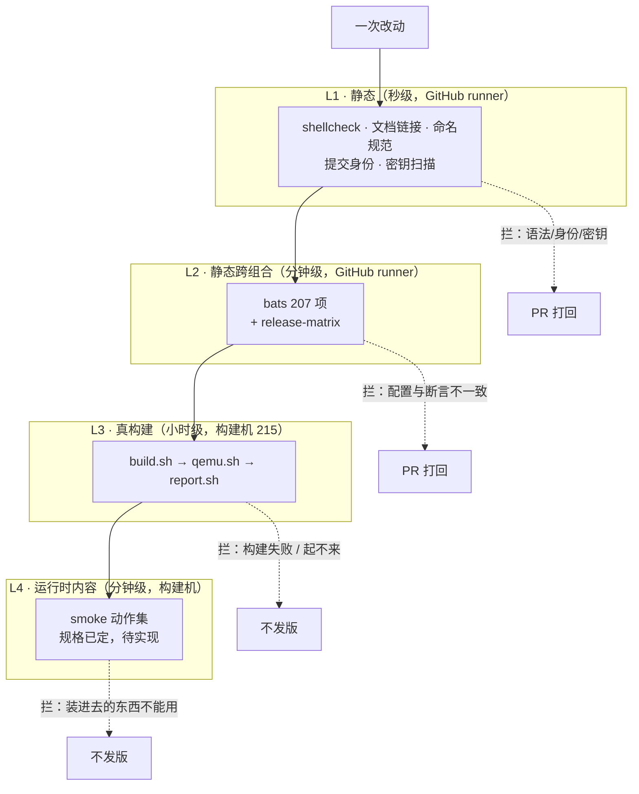
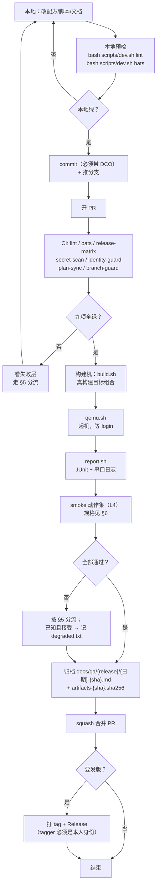
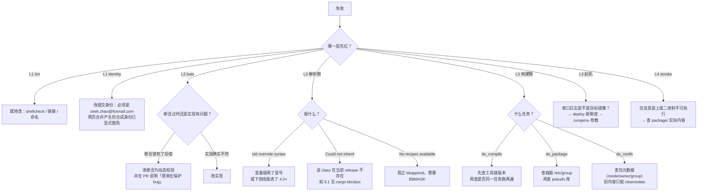

# 可验证性流程

> 本文件回答一个问题：**别人凭什么相信这里的产物是对的，以及他自己怎么复核。**
> 功能性流程在 [`functional-flow.md`](functional-flow.md)——那里讲「做出了什么」，
> 这里讲「怎么证明它是真的」。
>
> **验证边界（2026-11-09 决策）**：全部验证在 **QEMU + x86-64** 上完成。
> 不使用实体硬件，不覆盖 arm64。这两个边界是**主动声明**，写在 README 显眼位置，
> 不是等被问出来再解释。
>
> 最后更新：2026-11-09

## 0. 先把三个词定死

这三个词在本仓库有严格含义，混用会导致「看起来验证过」的假象。

| 词 | 这里的定义 | 不算 |
|---|---|---|
| **证据** | 能定位到 commit、命令、环境、阈值、产物摘要五要素的产物 | 一句「跑过了」、一张截图、一次口头确认 |
| **可复现** | 另一个人在同版本仓库上照抄命令，得到同一结论 | 「我这能跑」 |
| **通过** | 有明确判定阈值且实际达到 | 「没有报错」 |

判据的顺序很重要：**先有阈值，再看结果**。反过来就是给结果找解释。

## 1. 四层验证全景

四层的划分依据是**反馈时长**和**能发现什么类型的错**，不是「重要性」。
每层的存在理由都是「上一层的盲区」。



**每层的盲区，也就是下一层存在的理由**：

| 层 | 能发现 | **发现不了** | 所以下一层补什么 |
|---|---|---|---|
| L1 | shell 语法、身份、密钥、文档死链 | 任何 Yocto 语义 | 配方与配置的静态一致性 |
| L2 | 配置项写错、断言与现实不符、文件缺失 | 能不能真的编出来 | 真构建 |
| L3 | 解析错误、构建失败、起不到 login | **装进去的东西能不能用** | 运行时内容验证（L4） |
| L4 | 二进制存在但不可执行、库缺失、服务假活 | 上游测试是否全过（那是 ptest 的事） | — |

> L3 到 L4 这个缺口是本仓库最实质的质量漏洞：`#109` 那类事故（旧 sstate 恢复出
> 属性错乱的文件）正是在「构建成功 + 能起机」之后才被发现，而 207 项静态断言
> 那时**全绿**。静态断言测的是「文件在不在、内容长什么样」，不是「能不能跑」。

## 2. 一次改动的完整验证链



**关键点**：`degraded` 不是失败豁免，是**带记录的降级**。
写入 `degraded.txt` 的条件是「这个问题已知、已评估、不影响当前宣称的能力」，
且必须写清「什么情况下必须回来修」。没有这条记录的失败不能合并。

## 3. 证据规范：归档里必须有什么

`docs/qa/{release}/{日期}-{sha}.md` 每份都必须具备五要素。缺一项，这份归档就只是
「一次运行记录」，不能叫证据。

| 要素 | 具体形态 | 为什么必须有 |
|---|---|---|
| **可追溯 commit** | 文件名带 `{sha}`；报告头写完整 sha | 否则不知道测的是哪版 |
| **可追溯命令** | 报告里写完整命令行（含 release/variant/image/machine） | 否则无法重跑 |
| **可追溯环境** | 容器镜像 digest、bats 版本、宿主机内核 | 版本漂移会改变结论 |
| **判定阈值** | 用例数 / 失败数 / 跳过数，形如 `202 \| 202 \| 0 \| 0` | 「没报错」不是通过 |
| **产物摘要** | 同目录 `artifacts-{sha}.sha256`（相对仓库根的路径 + 摘要） | 证明归档与产物是同一份 |

已有的正面例子：

```
docs/qa/wrynose/20261104-ad7c52d-custom.md
docs/qa/wrynose/artifacts-20261104-ad7c52d.sha256
```

报告头的统计行形如：

```
| 202 | 202 | 0 | 0 |
```

读法是「总数 202 / 通过 202 / 失败 0 / 跳过 0」。
**跳过数不是零就必须解释**——跳过是最容易被用来掩盖失败的字段。

## 4. 判定阈值：什么算通过

不同层的阈值性质不同，不能统一成「rc=0」。

| 层 | 阈值 | 备注 |
|---|---|---|
| L1 lint | 全部 rc=0 | 无容忍项 |
| L2 bats | `总 / 通过 / 失败 0 / 跳过 0` | 跳过 > 0 需在 PR 里说明 |
| L3 构建 | `N tasks all succeeded`，无 warning 转 error | 任务数应与上次同组合可比；差异 >10% 要解释 |
| L3 起机 | 串口出现 `login:` 且不出现 panic | 「起来了但报错」不算通过 |
| L3 报告 | XML 首行是 `<?xml` 或 `<testsuites` | 混入其它输出会让解析器报离现场很远的错 |
| L4 smoke | 动作集全部 rc=0，`failed units` 为 0 | 规格见 §6 |

> 关于 XML 首行那条：CI 上真的踩过。`scripts/dev.sh` 首次运行会把
> `[dev] 构建 yocto-dev:local` 三行打到 stdout，被 `report.sh` 直接当 JUnit，
> 于是 `syntax error: line 1, column 0`。构建机上镜像早就存在，所以本地七轮全绿、
> CI 一上来就红。**只在干净机器上出现的 bug**，靠的就是这条阈值。

## 5. 失败分流

原则：**先定位到层，再定位到环节，最后才改代码**。跳过前两步就会「改三处猜中一处」。



**「断言过时」的识别方法**（这条值得单独记，因为它出现过）：

如果一个测试断言的是**一个具体的值**（版本号、路径、数字），而那个值来自
「当时的正确状态」，那么它会在未来的某次变更后**阻止正确修改**。
识别特征：改了实现之后门禁红了，但读实现代码发现新实现才是对的。
处理方式：把断言从「等于具体值」改成「与某个权威来源一致」。

实际案例：`04_layer.bats:52` 曾硬断言 `DISTRO_VERSION = "0.3.0"`，
于是任何想把它改成 `1.0.0` 的人都会被判红——**门禁在保护一个 bug**。
正确写法是「必须等于最近 tag」。

## 6. L4 运行时 smoke：规格（当前未实现）

这是 `DoD` 第③条，也是本仓库从「能起机」跨到「内容能用」的唯一一步。
**现在没有实现**，下面是待实现的规格。

### 6.1 动作集

起机到 login 后在目标镜像内执行，全部以退出码判定。

| 组 | 动作 | 通过条件 |
|---|---|---|
| busybox applet | `sh ls cat cp mv rm mkdir grep sed awk sort uniq head tail wc find tar gzip ping ip` 共 20 个 | 每个 `--help` 或最小执行 rc=0 |
| python3 | `python3 -c 'import json,sqlite3,ssl,hashlib'` | rc=0，且 `ssl.OPENSSL_VERSION` 可打印 |
| openssl | 自签证书 + `openssl s_client` 本地握手 | 握手成功，证书主题可读 |
| systemd | `systemctl list-units --failed` | 输出为空 |
| 自有服务 | `curl -s localhost:<port>/status`（若有 curl）/ `cat` 该端点 | 返回合法 JSON，含版本字段 |

### 6.2 阈值与形态

- 任一动作 rc≠0 → 整体判红，失败项逐条列出（不是「smoke 失败」一句话）。
- 结果输出为 JUnit XML，与 L3 的 bats 报告**分开归档**，避免混在一起看不出是哪层挂的。
- 运行时长预算：单组合 < 2 分钟（不含起机）。
- 只对 `custom` variant 的 `base` 与 `full` 跑；`minimal` 不含这些工具，跳过并注明。

### 6.3 它不证明什么

避免把它当成 ptest 的替代品：

- 不证明上游测试全过（那是 `ptest` 的事，已 icebox）
- 不证明性能达标（那是启动基线的事）
- 不证明所有包可用（只覆盖被点名的工具集）
- **不证明镜像可以长期运行**（只验证「装进去的东西能用一次」）

## 7. 外部复现：从零开始的命令序列

这一节的目标是：**一个没接触过这个仓库的人，能在半天内独立跑出一个绿结果并自己核对。**
如果他做不到，那「可验证」就是自说自话。

```bash
# 0. 前提：Linux + Docker，仓库在支持列表的架构上（x86-64）
git clone https://github.com/zeek-zhao/yp-distro.git && cd yp-distro

# 1. 先看「现在承诺什么」——不读代码也能读完
sed -n '1,60p' docs/engineering-overview.md

# 2. 静态层：确认门禁自己会红（不是只会在你这绿）
bash scripts/dev.sh bats          # 期望：全绿，失败 0，跳过 0

# 3. 真构建：只跑一个组合，别一上来跑全量
bash scripts/build.sh --release wrynose --variant custom --image full

# 4. 起机取证
bash scripts/qemu.sh --timeout 180

# 5. 出报告并与归档比对
bash scripts/report.sh
ls docs/qa/wrynose/ | tail -3
sha256sum -c docs/qa/wrynose/artifacts-<sha>.sha256
```

**核对点**（不止看 rc=0）：

1. 报告的用例总数是否与 `tests/bats/` 里的 `@test` 数量一致——不一致说明有文件没被跑到。
2. 串口日志末尾是否有 `login:`，且镜像 banner 里的版本与当前 tag 一致。
3. `sha256sum -c` 是否全 OK——不 OK 说明归档与产物不是同一份。

> 第 4 步的 `--timeout` 必须给。不给就会一直等，看起来像卡死，
> 实际是在等一个永远不来的提示符。

## 8. 当前缺口

诚实清单。这些不是「以后可能做」，是**现在确实没有**：

| 缺口 | 影响 | 状态 |
|---|---|---|
| L4 smoke 未实现 | 「内容能用」无证据，`DoD` 卡在第③条 | 规格已定（§6），待实现 |
| 无实体硬件验证 | 全部证据来自 QEMU；板级时序、电源、外设未覆盖 | **主动声明**，不计划补 |
| 单架构（x86-64） | arm64 及其他架构未覆盖 | 暂停，扩架构需先查硬编码假设 |
| 207 项断言偏静态 | 只测「文件在/内容长什么样」 | L4 补 |
| `--deep` 内容级扫描未做 | 旧 sstate 恢复型污染只能靠 L3 偶然撞见 | icebox |
| ptest 未接入 | 上游测试通过率未知 | icebox |
| 只读根 `/var` 不可写 | dm-verity 镜像 `journald` 落不了盘，`/var/lib` 只读 | `DoD` 第④条，待实现 |

## 9. 相关文档

- 功能全景 → [`functional-flow.md`](functional-flow.md)
- 范围与取舍 → [`engineering-overview.md`](engineering-overview.md)
- 归档目录约定 → [`qa/README.md`](qa/README.md)
- 排障方法论（更细） → [`handover.md`](handover.md) §三
- 踩坑结论条目 → [`knowledge-base.md`](knowledge-base.md)
